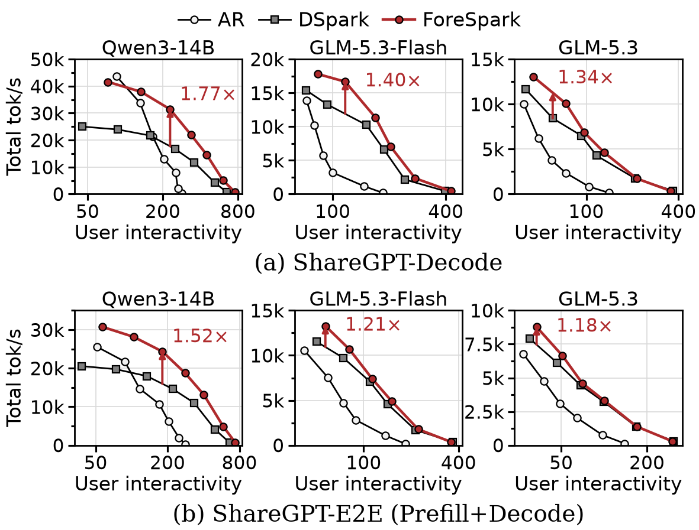
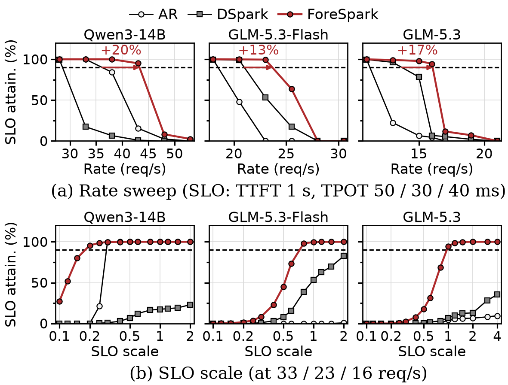
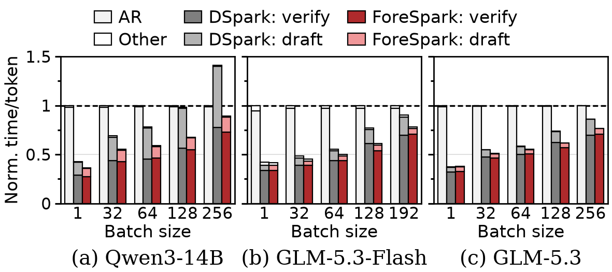
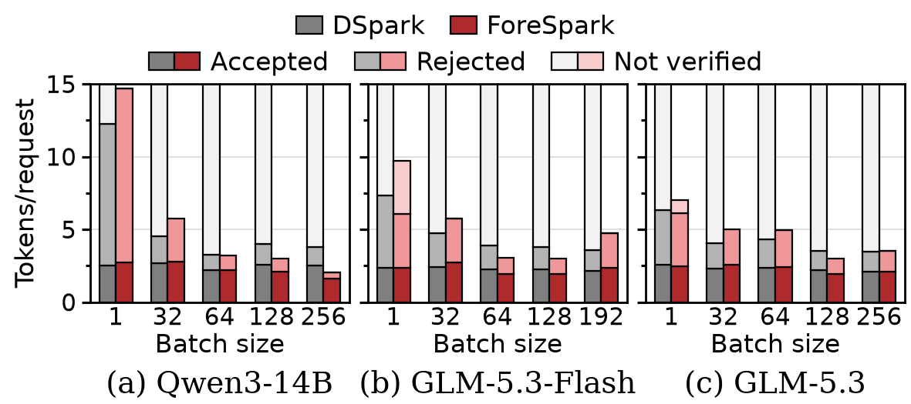

# ForeSpark

[](https://arxiv.org/abs/2611.13442)

Code for **ForeSpark: Joint Draft and Verification Budget Scheduling for Parallel Speculative Decoding**.

Parallel drafters propose a whole block of draft tokens in one forward pass. Goodput-aware systems such as DSpark
verify only the most promising drafts, yet every request still drafts a full block: under load, drafting takes up to
40% of the step, and most of it is never verified. ForeSpark implements *work-conserving speculation* (WCS): before
drafting, it sizes each request's draft and the batch's verification budget together, so drafting and verification
compute go only where they pay off. On vLLM it improves throughput by up to 1.77x over DSpark and 2.49x over
autoregressive decoding at matched per-user speed, and sustains up to 1.51x DSpark's request rate under latency SLOs,
without changing the output distribution.

## How it works

Each decoding step runs four stages on a DFlash2 parallel drafter:

1. **Pre-draft estimate.** A low-rank head reads the target's context feature and the embedding at each request's
   anchor and predicts acceptance for every candidate draft length. The drafter attends bidirectionally, so a
   length-d draft is not a prefix of a longer one: the head outputs a triangle of K(K+1)/2 logits, one row per length.
2. **Joint schedule.** The ForeSpark scheduler turns these estimates into per-request draft lengths D and a total
   verification budget B. It replaces each request's expected-acceptance curve by its concave envelope, pools the
   marginal gains of all requests in one global sort, and picks (D, B) to maximize expected tokens per step time,
   priced by latency tables measured on the server.
3. **Draft.** The drafter runs every request's block at its own length as one packed batch, so drafting cost scales
   with the tokens actually drafted.
4. **Distribute.** A post-draft estimator (a confidence head) re-scores the realized drafts, and B goes to the most
   promising positions batch-wide, as in DSpark's adaptive verification. Verification is standard speculative
   sampling, so outputs are unchanged.

The host plans the totals from the previous step's estimates and the GPU splits them per request with Triton kernels,
so the host never waits on the GPU; every stage replays CUDA graphs. The GLM targets' sparse-MLA kernels need each
request's lengths on the host, so for them the host makes the per-request split too. In the code, the pre-draft
estimator is the Fore-D head and the scheduling runtime is `forespark/fore_d/`.

## Results

The paper's measurements for the arms in this repository (`plot/`; K = 15, greedy decoding).



Total throughput against user interactivity (per-user tokens/s) on ShareGPT-Decode (fixed batches, decode only) and
ShareGPT-E2E (closed loop, prefill and decode sharing batches). Arrows mark the largest gain over the best baseline.



Open-loop ShareGPT-E2E: SLO attainment against the request rate (arrows: capacity at 90%), and at one rate as both
SLO thresholds are scaled.



Time per output token on ShareGPT-Decode, relative to AR at each batch size. At the largest batch, ForeSpark spends
67-76% less time drafting than DSpark.



Draft tokens per request per step in the same runs: accepted, rejected, or never verified. DSpark drafts all 15;
ForeSpark drafts close to what gets verified.

## Targets and arms

| | Qwen3-14B | GLM-5.3-Flash | GLM-5.3 |
|---|---|---|---|
| `configs/models.yaml` | `qwen14` | `glm53flash` | `glm53` |
| Weights / KV cache | BF16 / BF16 | NVFP4 experts / FP8 | NVFP4 experts / FP8 |
| Serving | 8x H100, TP8 | 8x B200, TP8 + EP8 | 8x B200, TP8 + EP8 |
| Drafter (layers x hidden) | 5 x 5,120 | 5 x 4,096 | 6 x 6,144 |
| Training GPUs (hidden-state server / trainer) | 2 / 6 | 4 / 4 | 4 / 4 |
| Max requests / tokens per step | 512 / 24,576 | 256 / 24,576 | 256 / 24,576 |
| SLO (TTFT / TPOT) | 1 s / 50 ms | 1 s / 30 ms | 1 s / 40 ms |

The arms are AR (`nospec`, the target alone), DSpark (`dspark`: adaptive verification with STS-calibrated
confidences) and ForeSpark (`forespark`). Every drafter runs at K = 15: a DFlash2 block of 16, a DSpark block of 15.

## Setup

`./setup.sh` builds the venv: vLLM 0.30.0 and speculators at pinned commits with `patches/` applied (neither is
vendored), then this package, editable. It needs GitHub, PyPI and Hugging Face access; where a proxy breaks Hugging
Face's Xet transfers ("File reconstruction error"), set `HF_HUB_DISABLE_XET=1`. `configs/paths.yaml` sets where data,
drafter runs, results and the venv live (`FORESPARK_<KEY>` overrides each). Run the CLIs with `.venv/bin/python`.

## Reproducing

One script per stage and target (`qwen14`, `glm53flash` or `glm53`); every stage resumes where it stopped.

```bash
scripts/training/train.sh qwen14         # corpus from scratch, then DSpark and ForeSpark
scripts/calibration/calibrate.sh qwen14  # estimator calibration and latency tables
scripts/bench/decode.sh qwen14           # ShareGPT-Decode
scripts/bench/e2e.sh qwen14              # ShareGPT-E2E
scripts/bench/slo.sh qwen14              # open-loop SLO attainment
.venv/bin/python plot/pareto.py          # also plot/slo.py, plot/breakdown.py, plot/acceptance.py
```

- **Training.** The corpus: Magpie and UltraChat prompts at pinned revisions, minus the benchmark's own prompts, with
  every response regenerated by the target. Each drafter then trains online, fetching target hidden states from a vLLM
  server: 3 epochs, 3,072 anchors per 8,192-token sequence, 0.1 cross-entropy + 0.9 total variation, AdamW with a
  cosine schedule, at 6e-4 (ForeSpark) and 3e-4 (DSpark). The pre-draft estimator learns one draft length per step
  from a gradient-free re-draft at that length from every fourth anchor; both estimators train on soft acceptance
  targets. `DATA_ARGS="--limit 2000" TRAIN_ARGS="--max-steps 20"` smoke-tests the whole procedure.
- **Calibration**, on held-out Alpaca prompts with every draft verified: per-position temperatures for both
  confidence heads (STS), a scale and bias per entry of the pre-draft estimator from one forced-length run per length
  1..K, verification latency tables from the same runs' step timer, and the ShareGPT-Decode prompt screening.
- **Benchmarks.** One TP8 server per arm and phase with identical caps; the grids and SLOs are the paper's
  (`scripts/env.sh`). `BENCH_ARGS` appends `eval.py` flags (e.g. `--concurrency 8 64`), and
  `eval.py report --results-root results/MODEL/bench` tabulates the results.
- **Figures.** Each `plot/` script writes `plot/plots/NAME.pdf` (`--out NAME.png` for a PNG). The paper's typefaces
  (`tahoma.ttf`, `times.ttf` in `plot/fonts/`) are optional.

## Heads-only training

ForeSpark's two estimators can also be fitted on an already trained drafter, with the drafter and the target frozen:
`scripts/training/heads.sh MODEL` extracts their inputs and labels from a slice of the corpus, fits both heads, and
writes the drafter with them, which calibrates and serves as any other (`heads.py extract`, `fit`, `merge`).

| GLM-5.3-Flash, 500 held-out batches | Trained with the drafter | Heads only |
|---|---|---|
| Cost | 55 h on 8 GPUs | 1 h on 8 GPUs |
| Confidence head: loss / Brier | 0.1773 / 0.0484 | 0.1775 / 0.0486 |
| Fore-D head: loss / accepted-token error | 0.511 / 0.688 | 0.522 / 0.729 |

## Layout

```
train.py heads.py serve.py data.py calibrate.py eval.py curves.py   thin CLIs
setup.sh            the venv: pinned vLLM + speculators, patches/ applied
configs/            models.yaml (targets), paths.yaml (storage)
patches/            vllm.patch, speculators.patch
forespark/
  models/           drafter (training and serving), pre- and post-draft estimators, vLLM registry
  fore_d/           scheduler (planner, latency model), Triton kernels, speculator runtime and CUDA graphs
  serving/          fixed-length drafting, STS, host-side ranking, decode barrier, TP-consistent verification
  train/            launcher, corpus, hidden-state server, heads on a frozen drafter, calibrations, training curves
  bench/            eval CLI, server launch, measurement protocol, prompts, reports
scripts/            env.sh (per-target settings), training/, calibration/, bench/
plot/  assets/      figure scripts in the paper's style; the paper's figures
tests/              unit and GPU tests: .venv/bin/python -m pytest tests -q
LICENSES/           the Apache License 2.0, for the files that adapt vLLM and speculators
```

## Patches

`patches/vllm.patch` (on v0.30.0) dispatches ForeSpark's drafter to this package's speculator and lets a speculator
bring its own verification manager; adds verified/drafted-token counters and the sampled per-step timer
(`--step-timing`); seeds unseeded requests from their id so every TP rank samples alike; serves non-causally trained
DSpark drafters non-causally; and adds hidden-state capture and drafter KV-cache support for the GLM targets.
`patches/speculators.patch` adds the pre-draft estimator's training, the backbone's re-draft at a given length,
per-group gradient clipping and the prompt-pool dataset for regeneration. To move a pin, change it in `setup.sh`,
re-run it, and regenerate a patch that no longer applies from `git -C .venv/src/vllm diff`.

## Citation

```bibtex
@article{song2026forespark,
  title   = {ForeSpark: Joint Draft and Verification Budget Scheduling
             for Parallel Speculative Decoding},
  author  = {Song, Jaeyong and Wang, Daniel and Patel, Pratyush and
             Kong, Jonny and Shah, Preyas and Kanaujia, Shobhit},
  journal = {arXiv preprint arXiv:2611.13442},
  year    = {2026}
}
```

## License

The majority of ForeSpark is licensed under CC-BY-NC, however portions of the project are available under separate
license terms: vLLM and speculators are licensed under the Apache 2.0 license, and Z Lab's DFlash is licensed under the
MIT license.

[LICENSE](LICENSE) holds the CC BY-NC 4.0 terms, and [LICENSES/Apache-2.0.txt](LICENSES/Apache-2.0.txt) the Apache
License 2.0. The files that adapt code from these projects keep its notices in their headers and stay under its
license: `forespark/models/layers.py` (MIT), and `forespark/models/{draft_model,vllm_model}.py`,
`forespark/serving/{cpu_ranking,dspark_sts,speculator}.py`, `forespark/fore_d/kernels/{packed_prep,selector}.py` and
`forespark/fore_d/runtime/graphs.py` (Apache 2.0). `patches/` modifies vLLM and speculators, which `setup.sh` fetches,
under their Apache 2.0 license. The models and datasets the scripts download keep their own licenses and terms. See
[CONTRIBUTING](CONTRIBUTING.md) to help out, and our [Code of Conduct](CODE_OF_CONDUCT.md).
